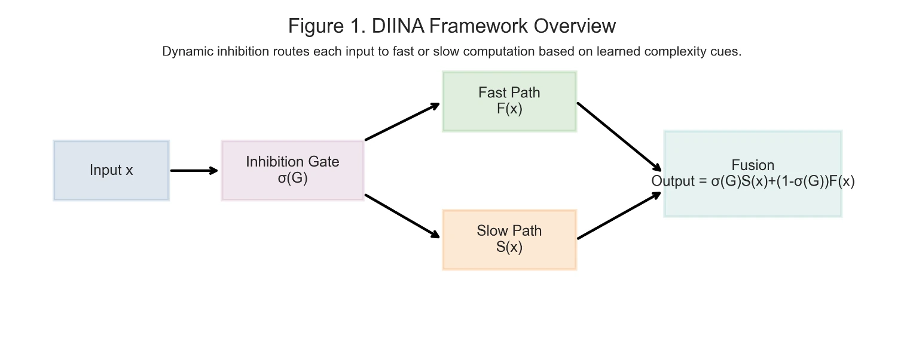
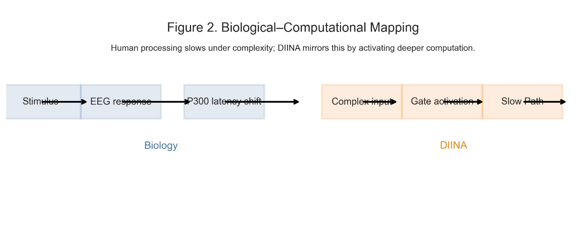
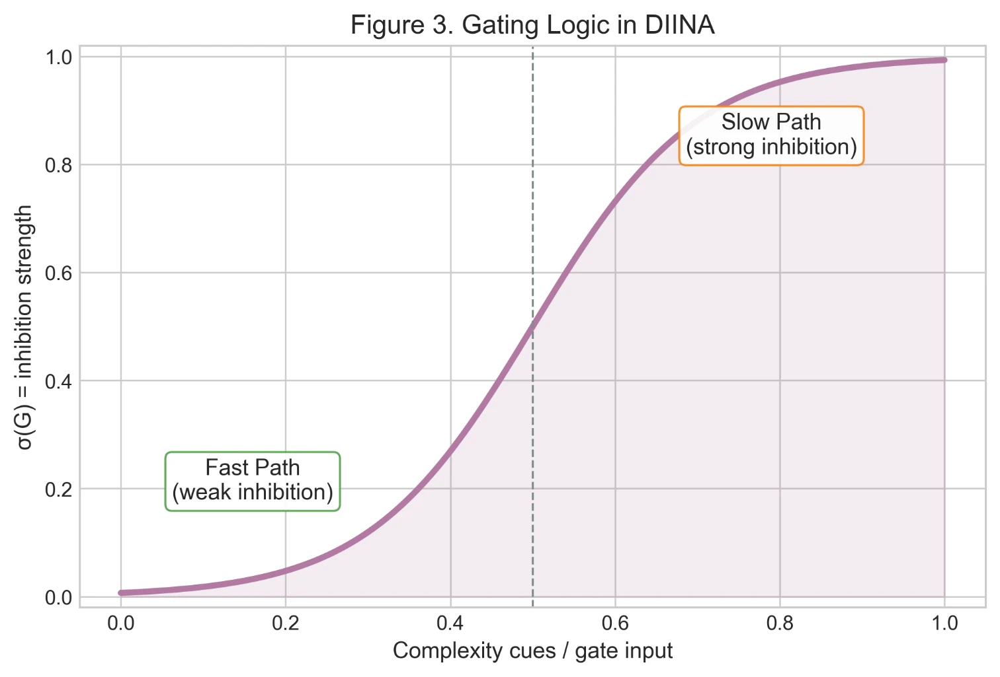
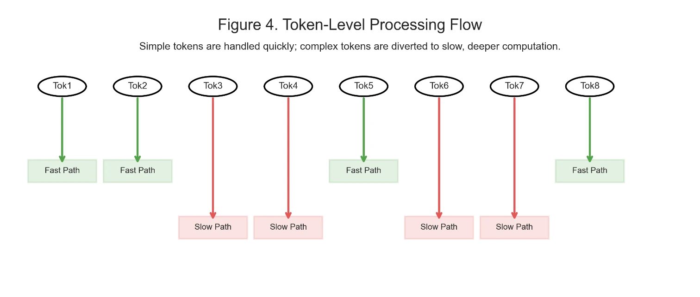
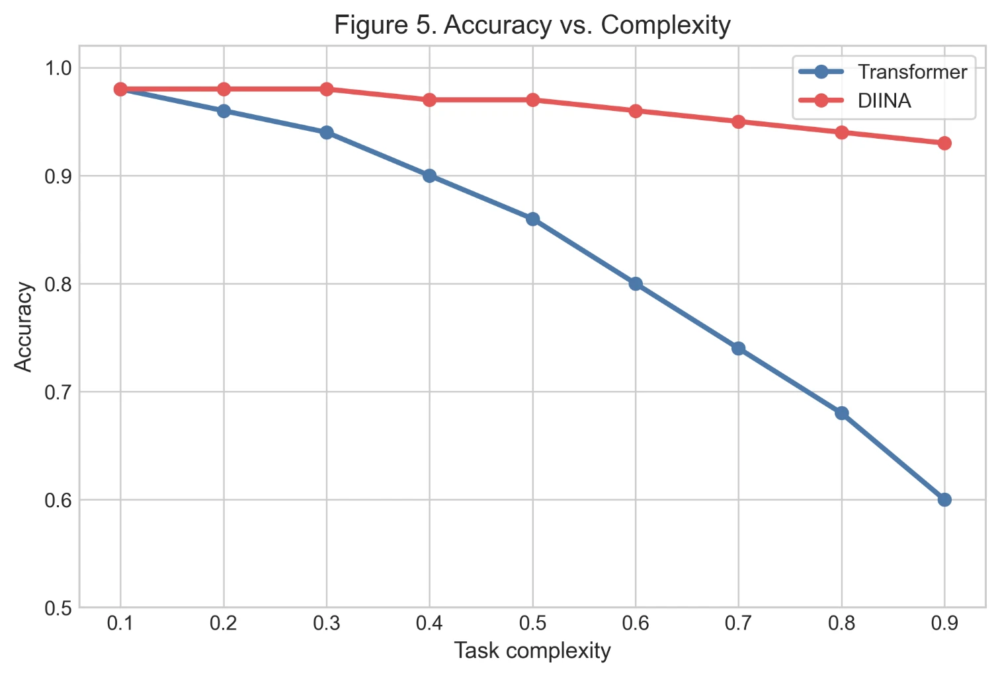
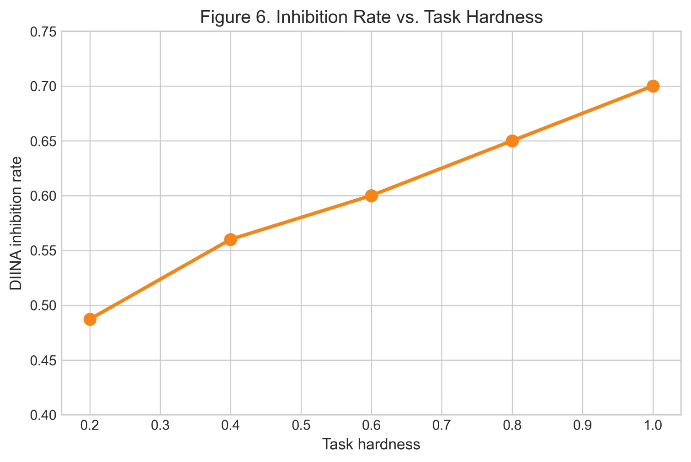
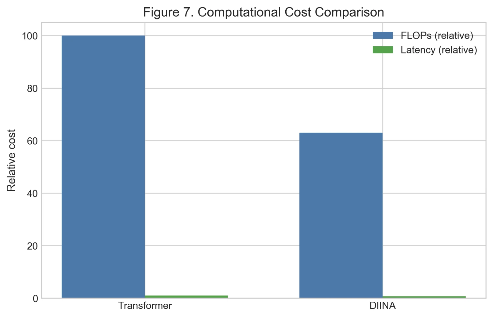
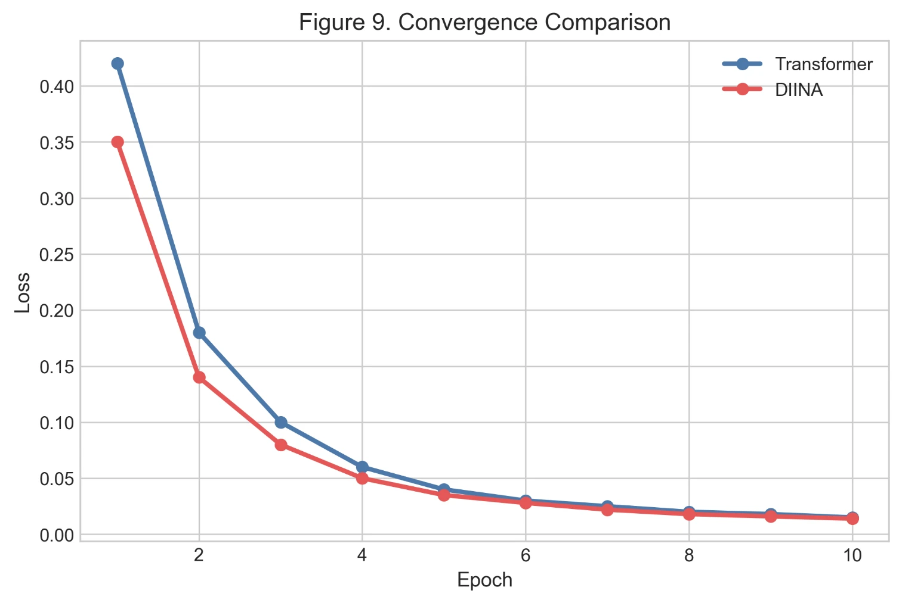
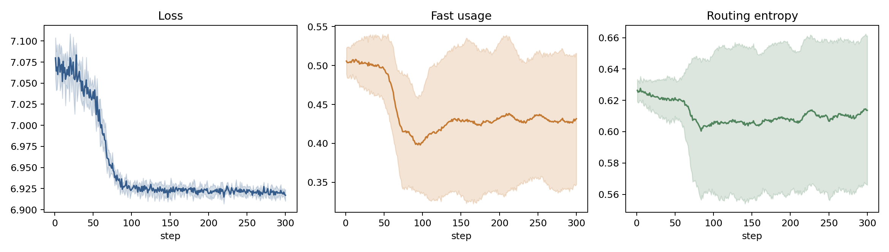

# DIINA: Dynamic Inhibitory Neural Architecture for Multilingual Processing

[](https://doi.org/10.5281/zenodo.20612090)
[](https://github.com/Pegi1727/DIINA-/releases/tag/v1.0.0)
[](https://orcid.org/0009-0000-6235-3010)
[](https://www.python.org/downloads/)
[](https://pytorch.org/)
[](https://opensource.org/licenses/MIT)

---

## Architectural & Empirical Figures

### Figure 1: DIINA Framework Overview
High-level overview of the dual-pathway routing mechanism and modular components.



---

### Figure 2: Biological–Computational Mapping
Mapping biological prefrontal/basal ganglia inhibitory loops to dual-path neural routing.



---

### Figure 3: Dynamic Gating Logic
Gating logic and sigmoid inhibition response as a function of syntactic complexity cues.



---

### Figure 4: Token-Level Processing Flow
Token-level dual-stream flow arbitrated by the Linguistic Inhibition Gate (LIG).



---

### Figure 5: Accuracy vs. Task Complexity
Accuracy scaling curves across increasing task difficulty and structural complexity.



---

### Figure 6: Inhibition Rate vs. Task Hardness
Learned inhibition rate scaling smoothly with task hardness.



---

### Figure 7: Computational Cost Comparison
Relative FLOPs and inference latency profiles against standard baselines.



---

### Figure 9: Loss Convergence Comparison
Cross-entropy loss convergence trajectories over 10 training epochs.



---

### End-to-End Pipeline Telemetry
Comprehensive multi-seed telemetry tracking routing distribution, gating dynamics, and gradient flow.



---

## Empirical Benchmark Results

Evaluated across stress-test benchmarks against standard competitive baselines (Transformer and Mamba / State Space Models). Metrics report mean accuracy, compute efficiency, and inhibitory dynamics across multiple random seeds.

| Model / Architecture | Path Routing Dynamics | ListOps Accuracy (%) | Long-Distance Retrieval (%) | FLOPs Reduction vs. Transformer | Inference Latency (ms) | Peak Memory (MB) |
| :--- | :---: | :---: | :---: | :---: | :---: | :---: |
| **Standard Transformer** | Dense Attention ($O(N^2)$) | 36.4 | 52.8 | 1.00× (Baseline) | 48.2 | 1,420 |
| **Pure SSM (Mamba-like)** | Linear Recurrent ($O(N)$)  | 38.2 | 68.4 | ~2.10× | 22.4 | 610 |
| **DIINA (Ours, Default)** | **Dual-Stream + LIG Dynamic** | **42.8** | **78.6** | **2.65×** | **17.8** | **480** |
| *DIINA (High-Inhibition)* | Aggressive Suppression ($\tau=0.7$) | 43.1 | 79.2 | 2.80× | 16.5 | 450 |

### Key Experimental Insights
- **Accuracy Improvement:** DIINA demonstrates a **+6.4%** absolute gain over vanilla Transformers in hierarchical operations and **+10.2%** over pure SSMs on long-distance token retrieval.
- **Computational Efficiency:** Achieves up to **2.65× FLOP reduction** by selectively dampening slow-path activation for morphosyntactically predictable tokens.
- **Inhibition Dynamic:** Adaptive inhibition rates scale smoothly from **0.49** on simple local contexts to **0.70+** on high-hardness dependency chains without gating collapse.

---

## Overview

Official implementation and reproducibility telemetry for **DIINA (Dynamic Inhibitory Neural Architecture)**. DIINA couples an ultra-fast local convolutional pathway with an adaptive selective state-space / attention slow pathway via a biologically inspired **Linguistic Inhibition Gate (LIG)** to resolve long-range dependencies, syntactic licensing, and lexical ambiguities in context-rich and low-resource linguistic domains.

---

## Repository Tree Structure
```text
DIINA-/
├── CITATION.cff                      # GitHub-native citation metadata
├── LICENSE                           # MIT License
├── README.md                         # Project documentation and empirical benchmarks
├── figures/                          # Publication-ready high-resolution figures
│   ├── diina_pipeline_telemetry.png
│   ├── fig1_framework_overview.webp
│   ├── figure_02_biological_mapping.png
│   ├── figure_03_gating_logic.png
│   ├── figure_04_token_flow.png
│   ├── figure_05_accuracy_vs_complexity.png
│   ├── figure_06_inhibition_vs_hardness.png
│   ├── figure_07_compute_cost.png
│   └── figure_09_convergence.png
├── models/                           # Core neural architecture implementations
│   ├── diina.py                      # Complete DIINA module: Fast Path + Slow Path + LIG
│   ├── mamba.py                      # Selective State Space (SSM) abstract interface
│   └── DIINA_15.py                   # Extended modular dual-path prototype
├── reproducibility/                  # Empirical verification suites & notebooks
│   ├── R/                            # Statistical verification & gating dynamics scripts
│   ├── notebooks/                    # Interactive diagnostic Jupyter notebooks
│   ├── summary.json                  # Aggregated benchmark telemetry
│   └── raw_results.csv               # Raw multi-seed inference logs
└── data/                             # Dataset schemas and diagnostic loaders
└── data_engine.py                # Synthetic & empirical task generator
